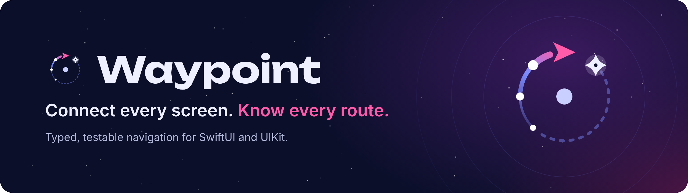

<p align="center">
  
  
  
  
  <a href="LICENSE"></a>
</p>

> [!WARNING]
> **Waypoint is in development and not ready for use.** There is no release yet, and the API can still change.

Waypoint is a navigation library for iOS apps. Every screen is named by a small route value, navigation lives in routers you can read and test, and SwiftUI or UIKit only draws what the routers say.

## Status

| Part | State |
|---|---|
| Routes, route keys and descriptions | ✅ Built in `WaypointCore` |
| Navigation state and pure reducers | ✅ Built |
| `StackRouter` and `TabRouter`: push, pop, present, dismiss, tabs, the router tree | ✅ Built |
| Transactions, path helpers, `else:` fallbacks and outcomes | ✅ Built |
| Logging seam | ✅ Built |
| SwiftUI renderer and app coordinator | 🛰️ Next |
| Child flows, root switching, UIKit renderer, deep links | 📐 Designed in DocC |
| Events, guards, restoration, `WaypointTesting` | 📐 Designed in DocC |

Built parts have unit tests that run on a Mac and on Linux. Designed parts are written as signatures in the DocC articles below and follow the same rules.

## Why Waypoint

- **One route type per screen.** Adding a screen is one route type and one registration line. There is no central `switch` over every screen, and a route's key comes from its type name, so routes declare no string keys.
- **One app coordinator.** The app's navigation lives in one place: the root (login or the main tabs), the tabs, child flows and incoming links. Screens report what happened, and the coordinator decides where to go.
- **State you can read.** Routers hold the whole navigation tree: stacks, sheets, tabs and child flows. Views and view models ask to move; they never own navigation state.
- **Safe by construction.** Mistakes are caught by the compiler where possible. Values are immutable, and every change goes through a function that checks it, so an invalid state can't be made. Anything only known at run time never crashes: every call returns an outcome, can name a fallback, and reports the issue with your file and line.
- **Logs you can search.** Routes, state, outcomes and issues print one stable line each, and route values stay private unless you list them.
- **Testable without a simulator.** `WaypointCore` is plain Swift, so navigation tests run as fast unit tests, on a Mac or on Linux.
- **SwiftUI and UIKit.** Both renderers draw the same core state, so a flow can mix SwiftUI and UIKit screens.

## A first look

### Routes

Name each screen with a small route:

```swift
import SwiftUI
import Waypoint
import WaypointCore

// Conformances:
// - `Route`, so it can be pushed, presented and saved.
struct ProductRoute: Route {
    let id: Int
}

// Conformances:
// - `Route`, so it can be pushed, presented and saved.
struct CartRoute: Route { }
```

### The router, today

`StackRouter` is built. Every call returns an outcome, and `else:` says what to do when a call can't be done:

```swift
let router = StackRouter()

router.push(ProductRoute(id: 42))

let outcome = router.popTo(CartRoute.self, else: .popToRoot)
print(outcome)
// recovered routeNotInPath by=popToRoot
```

The cart was never pushed, so the call recovers with its fallback instead of crashing. Without a fallback it returns `.failed`, and the issue names the file and line of the call.

### A flow

Give a flow its root screen and its destinations in a coordinator. Functions that navigate are named `show…()`:

```swift
// Conformances:
// - `SwiftUIStackCoordinator`, so `WaypointStack` can draw it.
final class ShopCoordinator: SwiftUIStackCoordinator {
    let router = StackRouter()

    var root: some View {
        ProductListView(onSelect: { self.showProduct(id: $0) })
    }

    var destinations: some Destinations {
        Destination(ProductRoute.self) { route in
            ProductView(id: route.id)
        }
    }

    func showProduct(id: Int) {
        router.push(ProductRoute(id: id))
    }
}
```

### The app

The app coordinator owns the app's navigation. Each `case` makes one named call, and functions that build a flow are named `make…Flow()`:

```swift
// Conformances:
// - `Hashable`, required by `RootRouter`, which compares roots to know when to switch.
// - `Codable`, required by `RootRouter`, which saves and restores the current root with the tree.
// - `Sendable`, required by `RootRouter`, so events that name the root can leave the main actor.
enum AppRoot: Hashable, Codable, Sendable {
    case login
    case main
}

// Conformances:
// - `SwiftUIRootCoordinator`, so `WaypointRoot` can draw it.
final class AppCoordinator: SwiftUIRootCoordinator {
    let router = RootRouter(AppRoot.login)
    let shop = ShopCoordinator()

    func makeFlow(for root: AppRoot) -> some View {
        switch root {
        case .login:
            makeLoginFlow()
        case .main:
            makeShopFlow()
        }
    }

    func makeLoginFlow() -> some View {
        LoginView(onLoggedIn: { self.showMainFlow() })
    }

    func makeShopFlow() -> some View {
        WaypointStack(shop)
    }

    func showMainFlow() {
        router.switch(to: .main)
    }
}

@main
struct ShopApp: App {
    @State private var app = AppCoordinator()

    var body: some Scene {
        WindowGroup {
            WaypointRoot(app)
        }
    }
}
```

`LoginView` doesn't import Waypoint. It calls `onLoggedIn`, and the rule for what happens next lives in one place you can test. The SwiftUI example flows add tabs, a sheet that returns a result, and deep links.

### A test

Test navigation without drawing anything:

```swift
@Test @MainActor
func selectingAProductPushesIt() {
    let shop = ShopCoordinator()

    shop.showProduct(id: 42)

    expectPath(shop.router) {
        ProductRoute(id: 42)
    }
}
```

A route with no destination never crashes either. Debug builds show a screen that names the route and the fix, and release builds refuse the push.

## Products

| Product | What it is | Runs on |
|---|---|---|
| `WaypointCore` | The navigation state engine: routes, routers, outcomes, fallbacks, transactions and logging, with coordinators, guards, deep links, restoration and events to come. No UI framework. | iOS, macOS, Linux |
| `Waypoint` | The SwiftUI renderer: `WaypointRoot`, `WaypointStack`, sheets, tabs, `WaypointLink` and coordinators. Built on `WaypointCore`. | iOS 17+ |
| `WaypointUIKit` | The UIKit renderer: navigation controllers, presentations and tab bar controllers driven by the same core. | iOS 17+ |

## Requirements

- iOS 17 or later
- Swift 6 (strict concurrency)
- Xcode 16 or later

## Installation

Waypoint is not released yet. When it is, add it with Swift Package Manager:

```swift
dependencies: [
    .package(url: "https://github.com/JoeOCT91/Waypoint.git", from: "0.1.0"),
],
targets: [
    .target(
        name: "MyApp",
        dependencies: [
            .product(name: "Waypoint", package: "Waypoint"),
        ]
    ),
]
```

Use `WaypointUIKit` for UIKit screens, and `WaypointCore` alone in a module that only decides where to go.

## Documentation

The API is written in DocC articles, one per topic. Articles for built parts match the code; the rest are the design the code will follow.

**Core** (`WaypointCore`)

| Article | What it covers |
|---|---|
| [Routes](Sources/WaypointCore/WaypointCore.docc/Routes.md) | Naming screens with small route types, and route keys from the type name |
| [Navigation state](Sources/WaypointCore/WaypointCore.docc/NavigationState.md) | The navigation tree the router holds |
| [Stack navigation](Sources/WaypointCore/WaypointCore.docc/StackNavigation.md) | Push, pop and replace, outcomes and `else:` fallbacks |
| [Presentation](Sources/WaypointCore/WaypointCore.docc/Presentation.md) | Sheets, full-screen covers, and sheet sizes, including sheets that fit their content |
| [Tabs](Sources/WaypointCore/WaypointCore.docc/Tabs.md) | Tab routers and their stacks |
| [Coordinators and child flows](Sources/WaypointCore/WaypointCore.docc/CoordinatorsAndChildFlows.md) | Grouping screens into flows |
| [Root switching](Sources/WaypointCore/WaypointCore.docc/RootSwitching.md) | The app coordinator, and swapping login for the main tabs |
| [Deep links](Sources/WaypointCore/WaypointCore.docc/DeepLinks.md) | URLs, push taps and shortcuts, applied in one step |
| [Guards](Sources/WaypointCore/WaypointCore.docc/Guards.md) | Allow, deny or redirect a move before it happens |
| [State restoration](Sources/WaypointCore/WaypointCore.docc/StateRestoration.md) | Saving and restoring navigation |
| [Descriptions](Sources/WaypointCore/WaypointCore.docc/Descriptions.md) | One stable, searchable line per value, with user data kept private |
| [Events and logging](Sources/WaypointCore/WaypointCore.docc/EventsAndLogging.md) | What changed, where it came from, and why |
| [Testing your navigation](Sources/WaypointCore/WaypointCore.docc/TestingYourNavigation.md) | Testing coordinators and view models without a UI |
| [Concurrency](Sources/WaypointCore/WaypointCore.docc/Concurrency.md) | The main actor, queued calls and navigators whose flow is gone |
| [Why these conformances](Sources/WaypointCore/WaypointCore.docc/WhyTheseConformances.md) | What each protocol on a route is for |

**SwiftUI** (`Waypoint`)

| Article | What it covers |
|---|---|
| [The SwiftUI renderer](Sources/Waypoint/Waypoint.docc/SwiftUIRenderer.md) | Stacks, links, coordinators, sheets and tabs |
| [Navigating from views and view models](Sources/Waypoint/Waypoint.docc/NavigatingFromViewsAndViewModels.md) | Outputs, injected navigators or property wrappers |
| [Example flows](Sources/Waypoint/Waypoint.docc/ExampleFlows.md) | Login, tabs, a push, a sheet and a deep link |

**UIKit** (`WaypointUIKit`)

| Article | What it covers |
|---|---|
| [The UIKit renderer](Sources/WaypointUIKit/WaypointUIKit.docc/UIKitRenderer.md) | Navigation controllers, presentations and tabs |
| [Example flows in UIKit](Sources/WaypointUIKit/WaypointUIKit.docc/ExampleFlowsInUIKit.md) | The same flows with view controllers |

## Contributing

Read [CONTRIBUTING.md](CONTRIBUTING.md) for how to run the tests and how pull requests are made. Changes are listed in [CHANGELOG.md](CHANGELOG.md).

## License

Waypoint is available under the MIT license. See [LICENSE](LICENSE).
